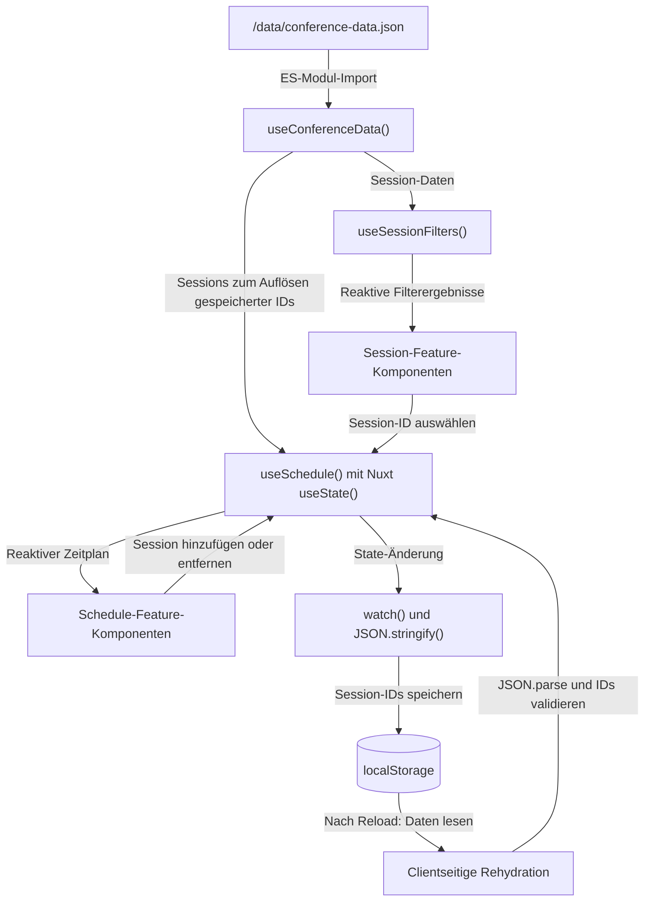

# State-Management-Konzept: „Mein Programm“ & conference-data.json

## Geteilter Datensatz

Die statischen, read-only Konferenzdaten liegen in `/data/conference-data.json`. Das **Composable `useConferenceData()`** importiert die JSON-Datei direkt als ES-Modul und stellt `conference`, `sessions`, `speakers`, `tracks` und `rooms` bereit - deswegen ist ein zusätzlicher `fetch` oder ein Backend nicht nötig. Der Datensatz wird beim Laden des Moduls eingebunden und steht anschließend synchron zur Verfügung. Durch das Modul-Caching greifen alle Komponenten auf dieselbe Datenquelle zu.

Die JSON-Struktur soll komplett unverändert bleiben: Sessions besitzen eindeutige IDs (`s01` bis `s20`) sowie Informationen wie Titel, Tag, Uhrzeit, Level und Format. Über `trackId`, `roomId` und `speakerIds` werden Beziehungen zu anderen Datensätzen hergestellt, ohne dabei vollständige Objekte zu duplizieren.

Da die Konferenzdaten statisch und read-only sind, brauchen sie keinen eigenen globalen Store. Mehrere Komponenten können über `useConferenceData()` auf denselben Datensatz zugreifen. Reaktivität wird erst für veränderliche Zustände wie Filterauswahl und persönlichen Zeitplan benötigt. Entsprechend unserer Headless-Architektur übernimmt `useSessionFilters()` die reaktive Filterlogik und stellt daraus mit `computed()` abgeleitete Session-Listen bereit. `SessionFilters.vue` dient als Filteroberfläche, während `SessionList.vue` die gefilterten Sessions darstellt.

## Persönlicher Zeitplan „Mein Programm“

Für den persönlichen Zeitplan ist nach unserer Architekturentscheidung das Composable `useSchedule()` zuständig. Es verwaltet den gemeinsamen reaktiven State und stellt Funktionen zum Hinzufügen und Entfernen von Sessions bereit. In Nuxt 4 planen wir dafür `useState()` mit einem eindeutigen Schlüssel einzusetzen, damit mehrere Komponenten denselben Zustand verwenden. Die zugehörigen Feature-Komponenten befinden sich unter `app/components/features/schedule/` - die Speicherlogik bleibt also von der Darstellung getrennt.

Gespeichert werden ausschließlich **Session-IDs als Array** (z.B. `["s01", "s07"]`), statt vollständiger Session-Objekte. Dadurch vermeiden wir Datenverdopplung, reduzieren den Speicherbedarf und verhindern veraltete Kopien von Session-Details. Die vollständigen Informationen werden über die IDs aus `sessions` ermittelt und mithilfe von `computed()` reaktiv für die Darstellung bereitgestellt.

Die **Persistenz** erfolgt ausschließlich clientseitig über `localStorage` unter dem Schlüssel `nextframe:my-program`. Beim ersten clientseitigen Initialisieren liest `useSchedule()` die gespeicherten Daten mittels `JSON.parse()`, prüft deren Struktur und gleicht die enthaltenen IDs mit dem Konferenzdatensatz ab. Ungültige oder nicht mehr vorhandene IDs werden verworfen. Anschließend wird der gemeinsame State wiederhergestellt (**Rehydration**), wodurch alle verwendenden Komponenten automatisch aktualisiert werden.

Spätere Änderungen werden durch `watch()` beobachtet und durch `JSON.stringify()` im `localStorage` gespeichert. Die clientseitige Initialisierung wird einmalig durchgeführt, die Synchronisation beginnt erst nach abgeschlossener Rehydration. Dadurch verhindern wir mehrfaches Initialisieren und vermeiden, dass vorhandene Daten durch einen anfänglich leeren State überschrieben werden. Da `localStorage` nur im Browser verfügbar ist, erfolgen sämtliche Speicherzugriffe ausschließlich clientseitig. Login, Server-State und eine eigene API sind für dieses Projekt nicht vorgesehen.

## Diagramm: Datenfluss & Rehydration

