# Verifikations-Nachweis

## 1. Testumgebung

NextFrame wurde anhand eines statisch generierten Nuxt-Produktionsbuilds überprüft.

- **Test-URL:** `http://localhost:3000`
- **Build:** `npm run generate`
- **Lokaler Server:** `npx serve .output/public`
- **Browser:** Google Chrome
- **Werkzeuge:** Chrome DevTools (Application, Network), Lighthouse 13.5.0
- **Testdatum:** 24.11.2026
- **Caching-Strategie:** Cache First gemäß [Offline-Konzept](02-offline-strategie-konzept.md)

Die folgenden Abbildungen dokumentieren die PWA-Konfiguration und belegen die in [03-entscheidungsprotokoll.md](03-entscheidungsprotokoll.md) beschriebenen Offline-Tests.

## 2. PWA-Installation und Service Worker

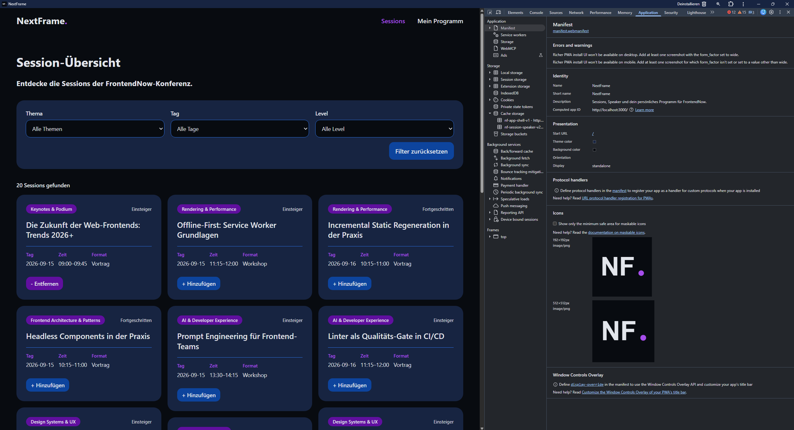

**Abbildung 1:** Installierte NextFrame-PWA mit gültig erkanntem Manifest (`Application → Manifest`). Name, Start-URL, Standalone-Modus, Farben und beide Icons werden angezeigt. Die Deinstallationsfunktion bestätigt die erfolgreiche Installation.

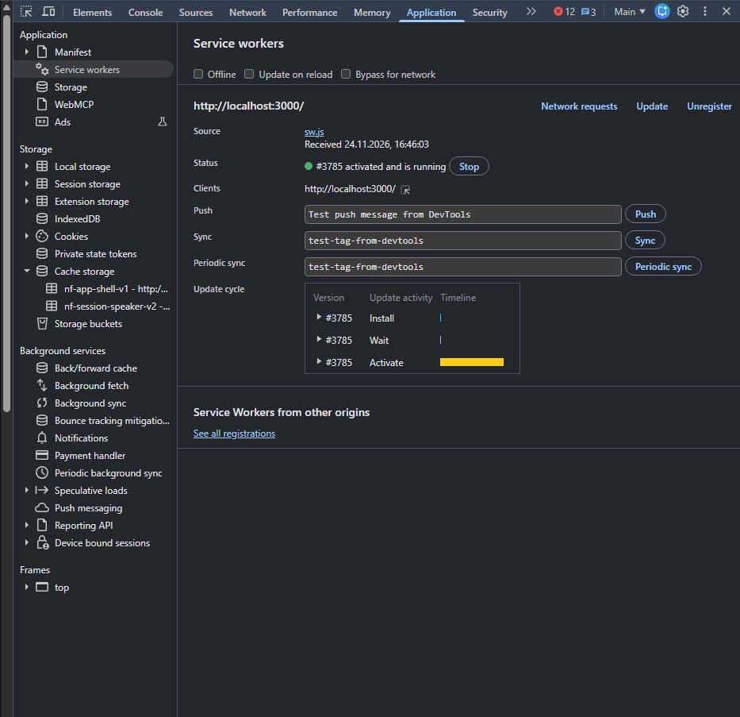

**Abbildung 2:** Registrierter, aktivierter und laufender Service Worker `/sw.js` (`Application → Service workers`). Beide Cache-Bereiche sind unter Cache Storage sichtbar.

## 3. Cache-First-Verifikation

### 3.1 App-Shell & Session-Übersicht

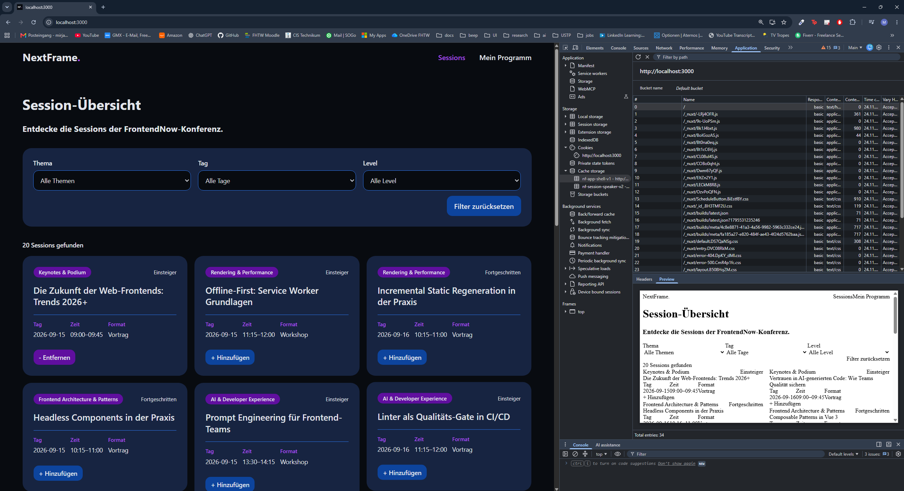

**Abbildung 3:** App-Shell-Cache `nf-app-shell-v1` mit zwischengespeicherten HTML-, JavaScript- und CSS-Ressourcen.

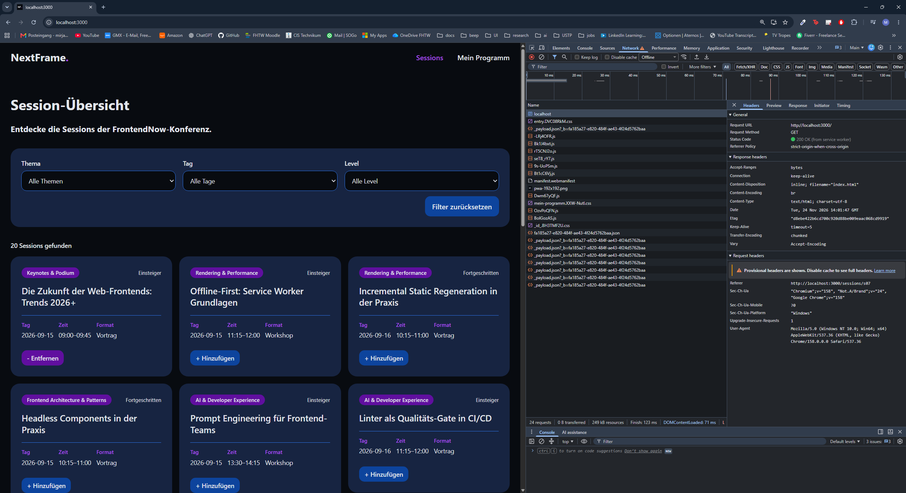

**Abbildung 4:** Session-Übersicht bei aktiviertem Offline-Modus. Die Dokumentanfrage wird mit HTTP 200 aus dem Service Worker beantwortet.

**Zuordnung:** D – Szenario 1 (Session-Übersicht offline)

### 3.2 Session- & Speaker-Daten

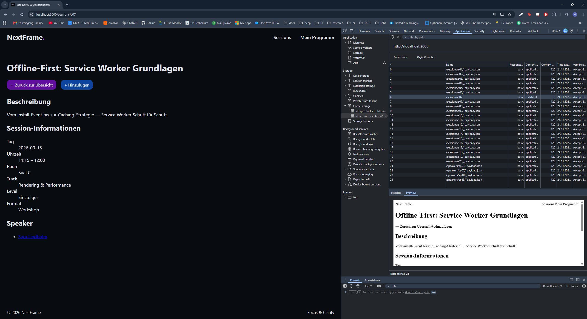

**Abbildung 5:** Separater Cache `nf-session-speaker-v2` mit vorliegenden Nuxt-Payloads und einer gespeicherten Session-HTML-Seite.

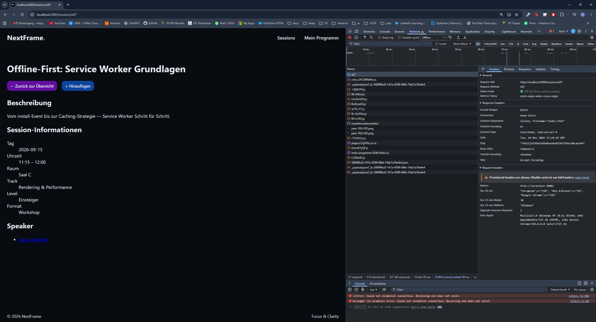

**Abbildung 6:** `/sessions/s07` wird im Offline-Modus mit HTTP 200 aus dem Service Worker geladen. Die Session-Informationen bleiben sichtbar.

**Zuordnung:** Ergänzender Test des Session-/Speaker-Cachings aus Aufgabe C

## 4. Offline-Szenarien aus D

### 4.1 "Mein Programm" offline

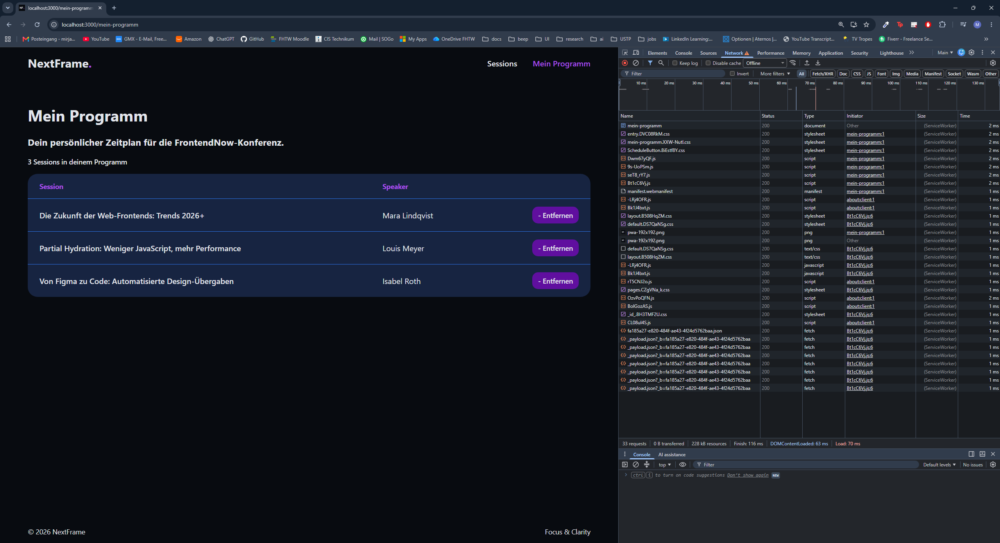

**Abbildung 7:** Das persönliche Programm bleibt offline mit drei ausgewählten Sessions vollständig sichtbar. Benötigte Ressourcen werden mit HTTP 200 durch den Service Worker ausgeliefert.

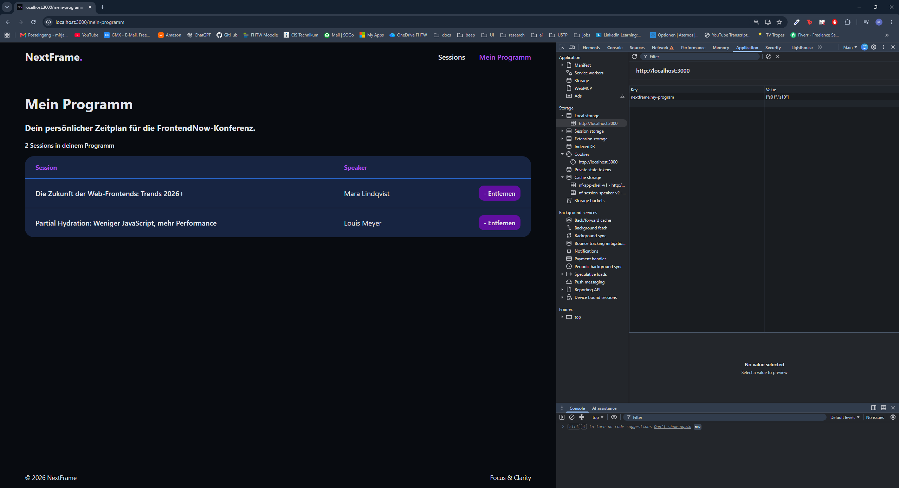

**Abbildung 8:** Nach dem Offline-Entfernen einer Session enthält `nextframe:my-program` weiterhin die zwei verbleibenden Session-IDs.

**Zuordnung:** D – Szenario 2 ("Mein Programm" offline)

### 4.2 Erstbesuch ohne Cache

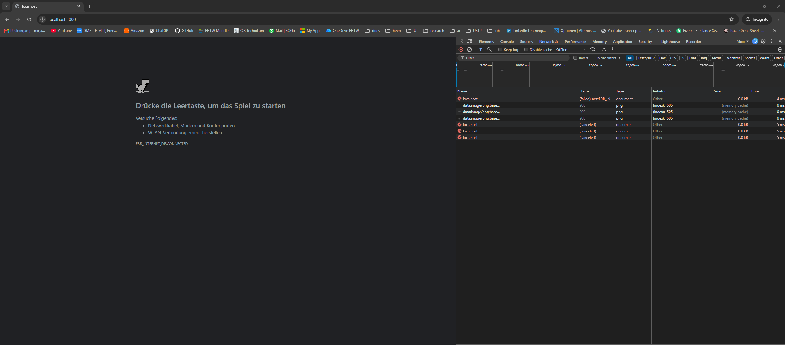

**Abbildung 9:** Fehlgeschlagener Erstbesuch im frischen Inkognito-Kontext bei aktiviertem Offline-Modus (`ERR_INTERNET_DISCONNECTED`).

**Zuordnung:** D - Szenario 3 (bewusster Offline-Grenzfall)

## 5. Lighthouse-Audit

Die Startseite wurde ergänzend mit **Lighthouse 13.5.0** überprüft. Da diese Version keine eigene PWA-Audit-Kategorie anbietet, wurden Installierbarkeit, Manifest und Service Worker zusätzlich über Chrome DevTools verifiziert. Nach dem ersten Audit wurden der HTML-Seitentitel, das Sprachattribut und die Meta-Description ergänzt. Anschließend erfolgte eine zweite Messung.

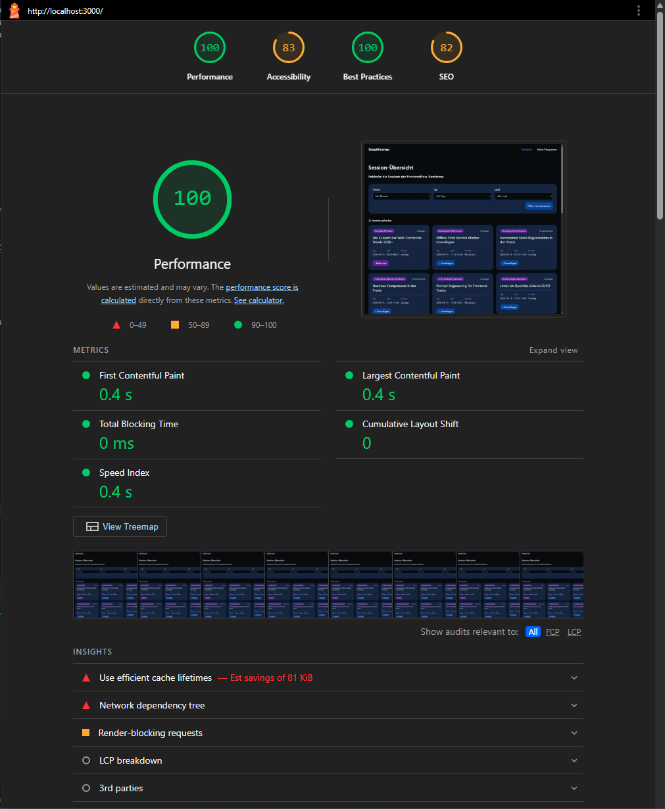

**Abbildung 10:** Lighthouse-Ausgangsmessung vor Ergänzung der HTML-Metadaten.

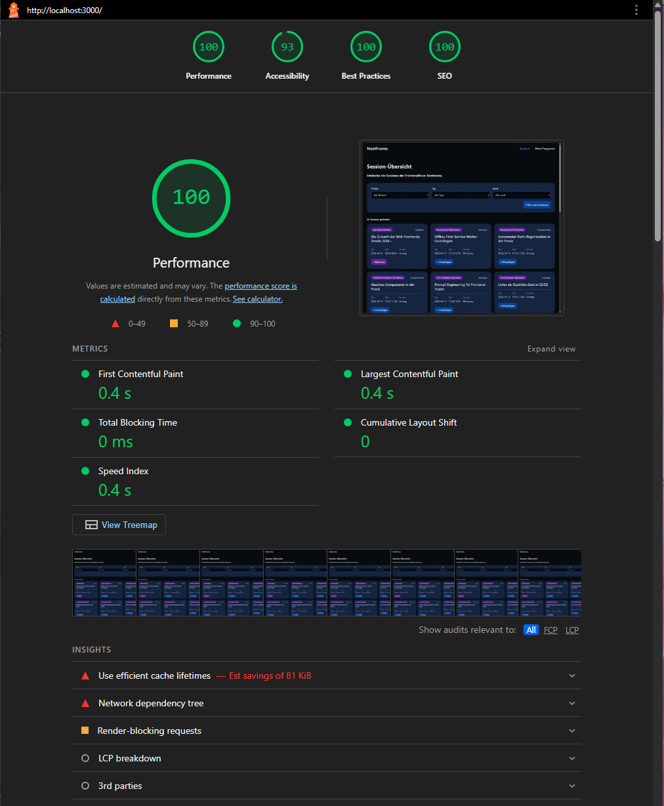

**Abbildung 11:** Lighthouse-Messung nach Ergänzung der HTML-Metadaten.

| Kategorie | V1 | V2 | Veränderung |
|---|---:|---:|---:|
| Performance | 100 | 100 | – |
| Accessibility | 83 | 93 | +10 |
| Best Practices | 100 | 100 | – |
| SEO | 82 | 100 | +18 |

**Vollständige Berichte:**

- [Lighthouse V1 – Ausgangsmessung](reports/lighthouse-v1.html)
- [Lighthouse V2 – Nach den Verbesserungen](reports/lighthouse-v2.html)

## 6. Zusammenfassende Einordnung

Die PWA NextFrame wurde unter `http://localhost:3000` anhand eines statisch generierten Nuxt-Builds überprüft. In Chrome DevTools wurden das Manifest, die Service-Worker-Registrierung, die Cache-Speicher und das Netzwerkverhalten kontrolliert. Das Manifest wurde korrekt erkannt und NextFrame ließ sich als eigenständige Anwendung installieren. Der Service Worker war aktiviert und wurde ausgeführt.

Für die Offline-Tests wurden die relevanten Seiten zunächst online geladen und anschließend über `Network → Offline` ohne Netzwerk erneut geöffnet. Die Session-Übersicht blieb vollständig dargestellt; ihre HTML-Antwort wurde mit Status 200 aus dem Service Worker geliefert. Auch eine zuvor gespeicherte Session-Detailseite war offline erreichbar. Die App-Shell-Ressourcen und Session-/Speaker-Payloads waren in getrennten Caches vorhanden. Das persönliche Programm blieb offline nutzbar: Bereits ausgewählte Sessions wurden angezeigt und eine Session konnte entfernt werden. Die verbliebenen Session-IDs waren im `localStorage` gespeichert. Beim Erstbesuch ohne vorheriges Online-Laden erschien erwartungsgemäß `ERR_INTERNET_DISCONNECTED`.

Ergänzend wurden zwei Lighthouse-Audits durchgeführt. Nach der Ergänzung von HTML-Metadaten verbesserten sich Accessibility von 83 auf 93 und SEO von 82 auf 100 Punkte. Performance und Best Practices erreichten jeweils 100 Punkte. Verbleibende Einschränkungen sind einzelne Accessibility-Probleme sowie die notwendige erstmalige Online-Initialisierung.